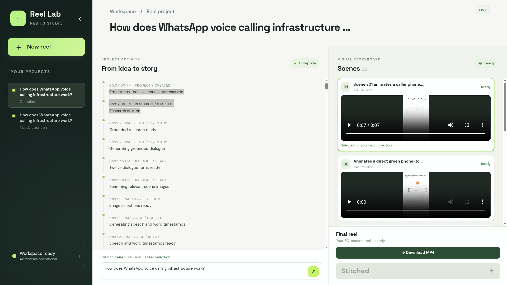
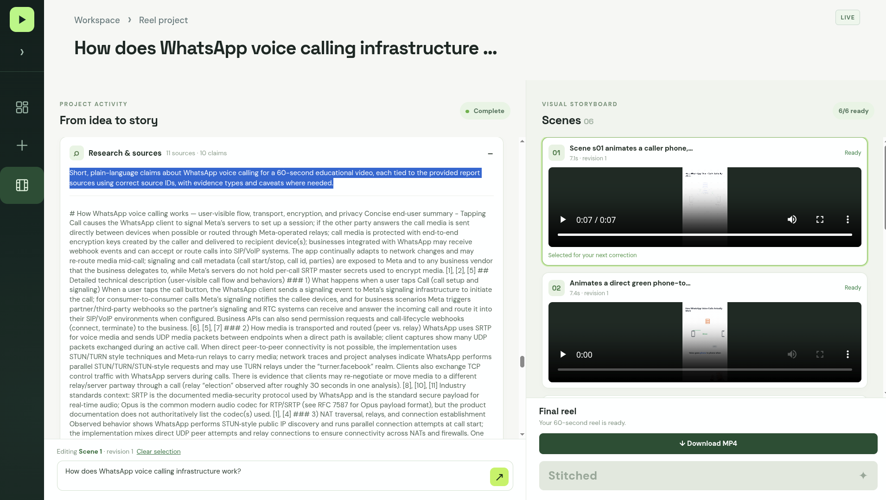
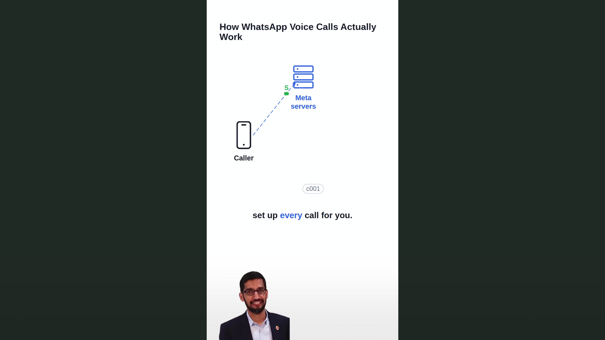
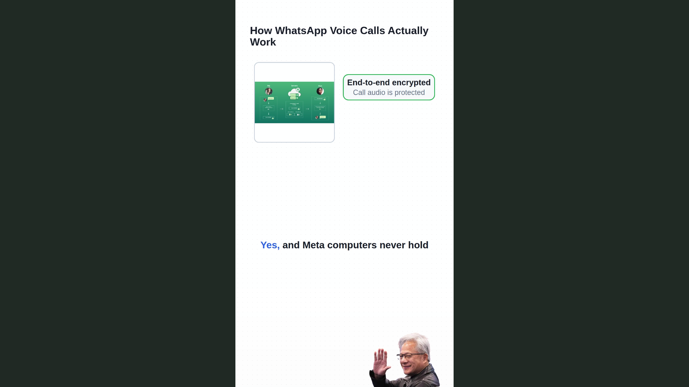
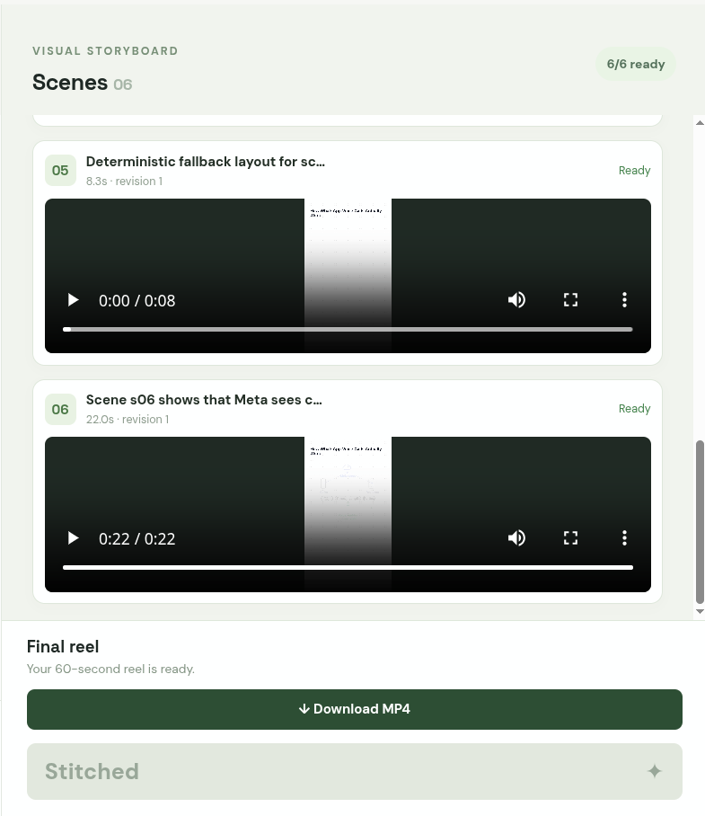
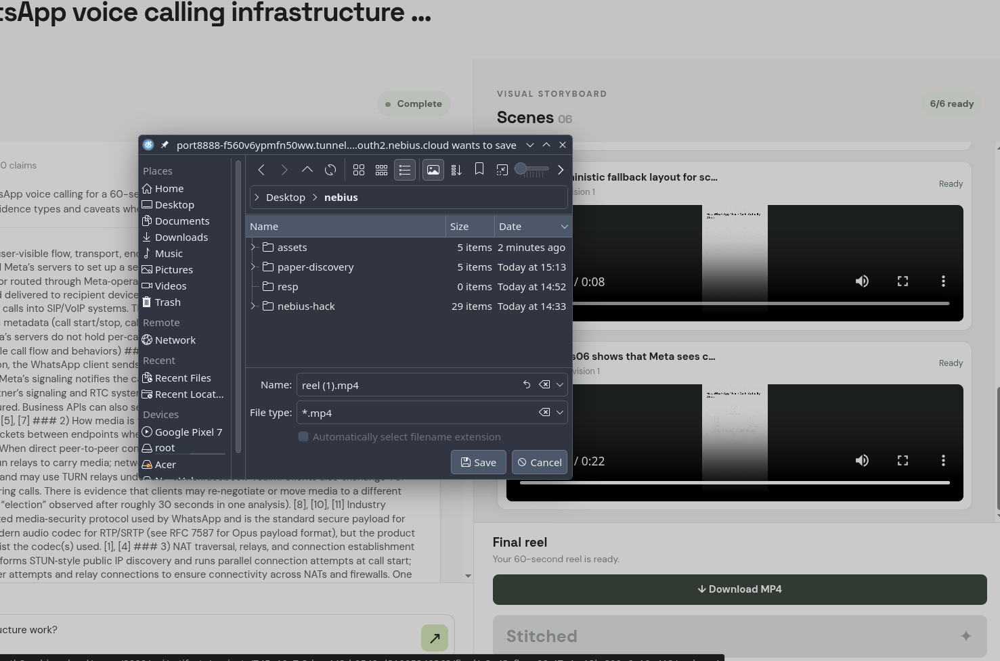
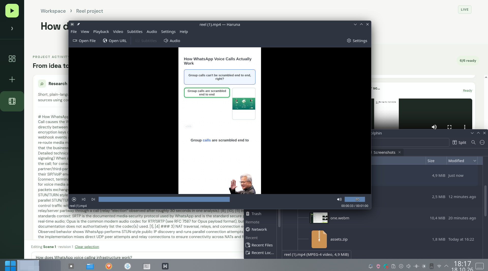
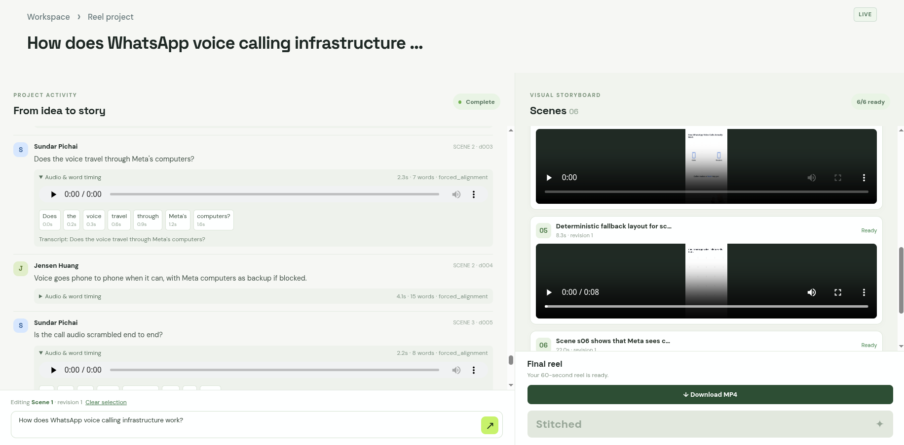

# Reel Lab

**Turn a question into a researched, narrated, animated one-minute reel.**

Built for Nebius Build Week with Tech Europe. Reel Lab brings research, AI dialogue, voice generation, and video creation into one workspace. You can review the sources, watch each scene arrive, ask for a change to one scene, and combine the result into a vertical video.

For example, enter **“How does WhatsApp voice calling infrastructure work?”** The app researches the topic, writes a conversation that explains it, and creates animated diagrams timed to the spoken words.

## How it works

1. **Give it a topic.** Create a project by entering the question you want your reel to explain.
2. **Review the research.** Tavily Deep Research gathers a report and sources. The app keeps factual claims connected to that evidence.
3. **Get a conversation.** NVIDIA Nemotron writes a short discussion: one character asks skeptical questions, and the other explains or challenges the premise. It also plans image searches for relevant illustrations.
4. **Generate speech and word timing.** Chatterbox Turbo generates speech from the dialogue and reference audio. WhisperX measures when each word is spoken so captions and animations can follow the audio.
5. **Watch scenes appear.** Independent scene agents create six animated scenes using shared research, timing, and design rules. Previews appear as they finish, in their correct numbered slots.
6. **Refine and stitch.** Send an instruction such as “Please correct scene six: make the packet diagram clearer.” Once the scenes are ready, press **Stitch reel** to produce the final MP4.

The demo uses Sundar Pichai and Jensen Huang as scripted characters, with supplied character images and voice samples. The dialogue is AI-generated; it is not a recording or quotation of an actual conversation between them.

## The workspace

The editor keeps your projects in a sidebar, research and dialogue in the center, and scene previews on the right. Expand the research to inspect sources or a dialogue turn to see its audio and word timestamps. Each scene can be revised separately while completed work is preserved.

The video uses a white dotted notebook background. The upper 70% is a workboard for diagrams and explanations; the lower 30% holds character images that move with the speaking turns. The output is a **60-second, 1080 × 1920, 9:16 video at 30 frames per second**, suitable for a vertical reel.

## Screenshots

Follow the workflow from topic to reel, in chronological order.

















## Technology we use

| Technology | What it does in Reel Lab |
| --- | --- |
| **Nebius Cloud GPU Devlab** | Hosts the application, speech services, and video rendering worker. The current deployment uses an NVIDIA RTX PRO 6000 Blackwell GPU. Speech uses the GPU; the API and Remotion renderer use CPU resources. |
| **Nebius Token Factory + NVIDIA Nemotron** | Provides hosted model inference for dialogue, image-search planning, scene generation, and scene-edit routing. The configured model is `nvidia/Nemotron-3.5-Super-VL`. |
| **Tavily Deep Research and Search** | Researches the topic, supplies source material, and finds relevant images. |
| **LangChain and scene agents** | Turns model responses into structured data and supports independent agents that generate and repair scene code. A single-call scene mode is also available. |
| **Chatterbox Turbo** | Generates each character’s spoken dialogue using supplied reference audio, hosted on our Nebius GPU. |
| **WhisperX** | Aligns the known script to the generated audio and returns measured word timestamps for captions and animation cues. |
| **Remotion + React** | Turns scene code, audio, captions, and character images into preview videos and the final MP4. |
| **Python + FastAPI** | Runs the backend, coordinates pipeline stages, tracks progress, and serves project artifacts. |
| **Pydantic** | Defines and validates the data passed between research, dialogue, voice, scenes, and rendering. |
| **React + Vite + TypeScript + CSS** | Powers the browser editor and its progressive scene previews. |

Scene agents receive the same locked research, dialogue, theme, timing, and boundary information. They can work concurrently without exchanging messages. A Python coordinator manages stage dependencies and publishes progress; it also preserves completed artifacts for retries.

## Run locally

Requires **Python 3.12**, **uv**, and **Node.js 22+**. The speech services have separate Python environments and GPU dependencies; see the deployment guide for those.

From the repository root:

```bash
uv sync --python 3.12
# Only copy this if you do not already have a .env file:
cp .env.example .env
uv run uvicorn backend.app:app --host 0.0.0.0 --port 8000 --workers 1
```

In another terminal:

```bash
cd frontend
npm ci
npm run dev
```

Open `http://localhost:5173`. API documentation is available at `http://localhost:8000/docs`. Keep one API worker because project state and operation locks are managed by the current file-backed implementation.

For a **frontend-only demonstration**, open `http://localhost:5173/?mock=1`. It needs no provider keys and uses browser fixtures, silent audio, and a placeholder video. It demonstrates the editing workflow rather than live research, speech, or rendering.

### Live configuration

Use [`.env.example`](.env.example) as the configuration reference. Live operation requires:

- `NEBIUS_API_KEY` for Nemotron inference through Nebius Token Factory.
- `TAVILY_API_KEY` for research and image search.
- Running Chatterbox, WhisperX, and Remotion services, with their URLs configured.
- Your own shared service secrets: `VOICE_API_KEY`, `ALIGNMENT_API_KEY`, and `RENDER_WORKER_TOKEN`.
- `MOCK_MODE=false` and the character assets below.

Provider credentials stay on the backend. Store them in the ignored `.env`, never in frontend code or committed files. Nebius infrastructure provisioning is separate from the Token Factory inference key.

```text
assets/
├── characters/
│   ├── sundar.png
│   └── jensen.png
├── voices/
│   ├── sundar/reference.wav
│   └── jensen/reference.wav
└── ss/                         # README screenshots
```

Use transparent PNGs for the characters. WhisperX aligns each generated audio clip before the timeline is locked; animations use those measured times.

## Project layout

| Location | Responsibility |
| --- | --- |
| `frontend/` | Browser editor, project list, dialogue, previews, and scene correction controls |
| `backend/core/` | API, coordinator, persistence, shared runtime, and timeline |
| `backend/modules/content/` | Research, grounded dialogue, and image selection |
| `backend/modules/voice/` | Speech generation, audio normalization, and word alignment |
| `backend/modules/scenes/` | Scene generation, revision routing, and rendering integration |
| `contracts/` | Shared Pydantic models, validation, and exported schemas |
| `renderer/` | Remotion compositions and Node.js rendering worker |
| `infra/` | Deployment configuration and instructions |
| `output/` | Generated project artifacts and videos; excluded from Git |

## Current scope

The live Nebius pipeline has produced research, dialogue, speech with word alignment, and all six scene previews. Scene generation includes a deterministic fallback when generated code is unusable; the latest demo used it for scene five. A completed live final MP4 has not yet been verified.

This hackathon version focuses on six editable scenes and a one-minute export. Direct Instagram publishing, lip sync, background music, and multi-user collaboration are outside the current scope.

For deployment, read [`infra/README.md`](infra/README.md). For architecture and team contracts, read [`context.md`](context.md) and [`plan.md`](plan.md). For the latest operational handoff, read [`agents.md`](agents.md).
